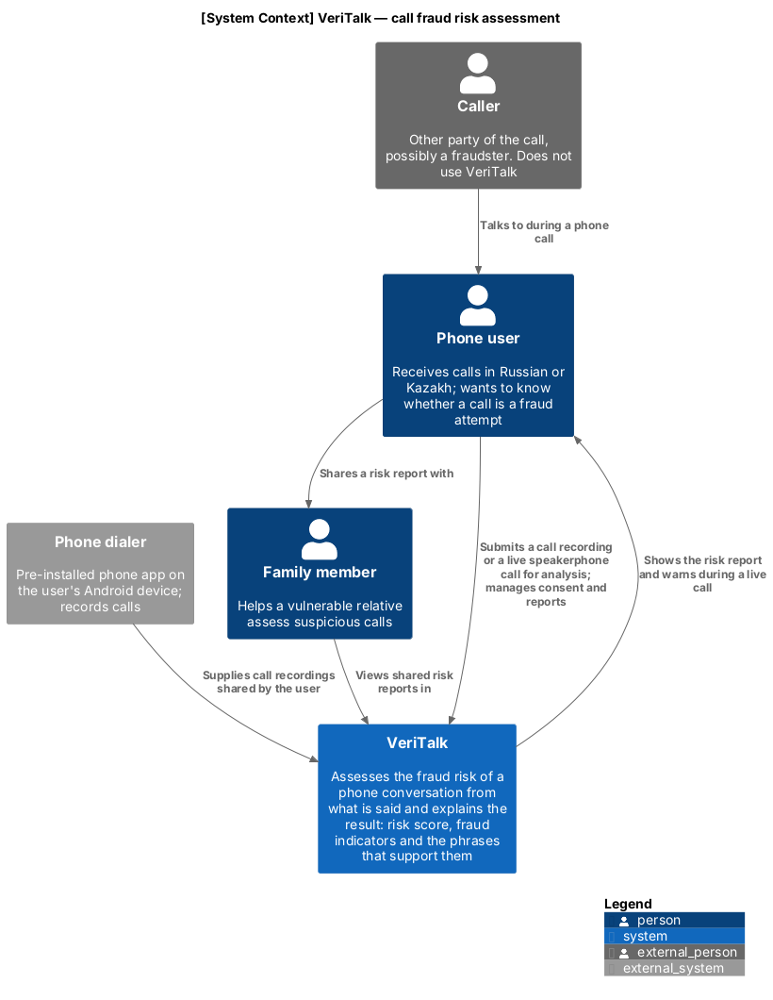
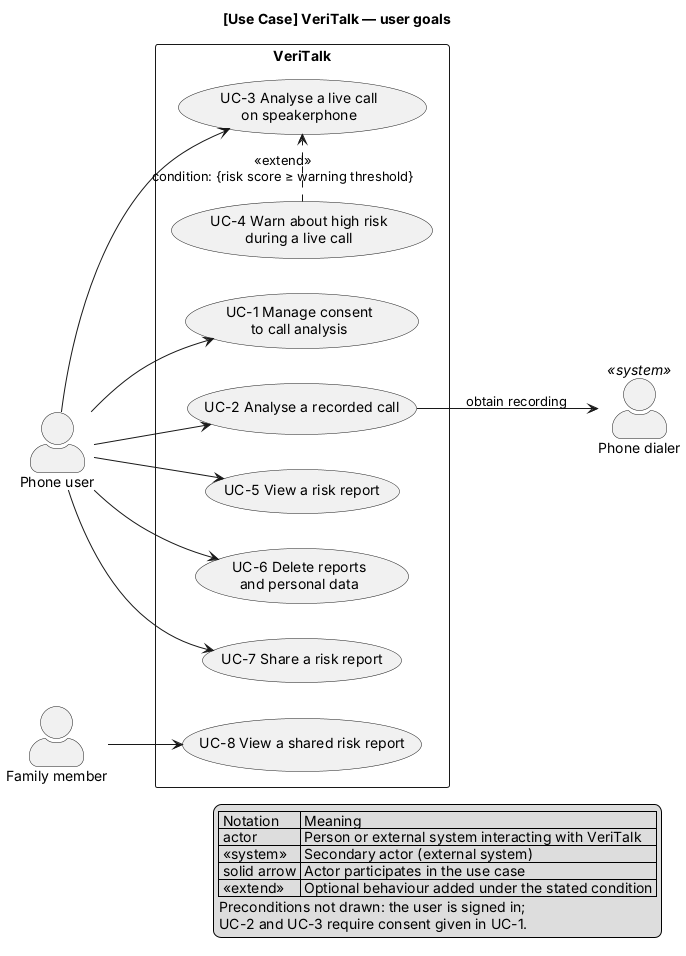
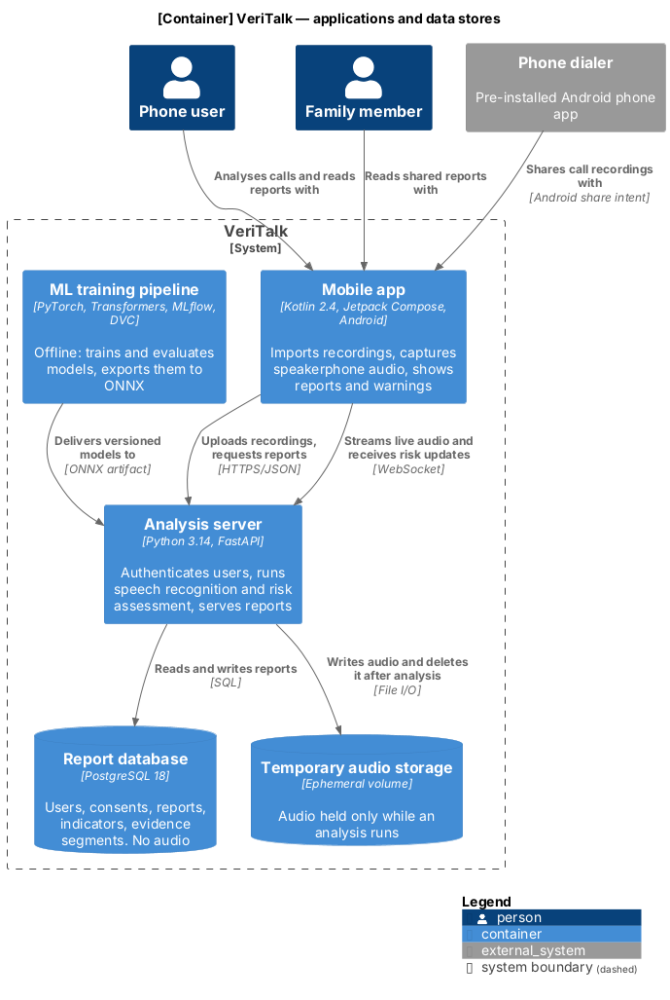
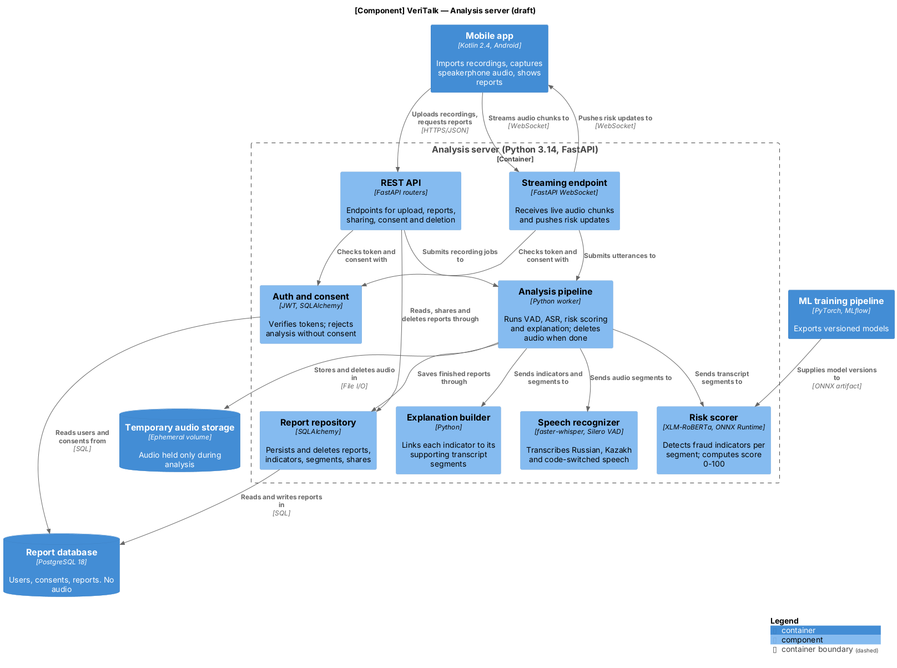

# Architecture Description

**Project:** VeriTalk — Development of an Application for Assessing the Risk of Phone Conversations Using Artificial Intelligence
**Task:** VRT-8 Architecture and diagrams
**Date:** Oct. 20, 2026
**Status:** Draft for pre-defense 1. The component view is a draft and will be refined during implementation.

## I. Overview

VeriTalk is a client–server system. A native Android application imports call recordings or captures speakerphone audio and presents results; an analysis server transcribes the audio, detects fraud indicators, computes a risk score and builds an explanation. Machine learning models are trained offline and delivered to the server as versioned artifacts. The technology choices are justified in [05-technology-comparison.md](05-technology-comparison.md).

Three architectural principles follow from the proposal:

1. **Content-based and explainable.** Every result contains a risk score (0–100), the detected indicators, and the transcript segments that support each indicator (proposal O3).
2. **Privacy by design.** Audio exists only in temporary storage while an analysis runs and is then deleted; only the report is stored, subject to user consent (proposal, Scope).
3. **Two analysis modes, one pipeline.** Recordings and live speakerphone audio pass through the same VAD → ASR → risk scoring → explanation pipeline; only the transport differs (proposal O4).

## II. Diagrams and Conventions

| # | Diagram | Notation | Scope | Source | Exports |
| --- | --- | --- | --- | --- | --- |
| 1 | System context | C4 level 1 | VeriTalk as one system | [01-system-context.puml](../diagrams/01-system-context.puml) | [SVG](../diagrams/01-system-context.svg), [PNG](../diagrams/01-system-context.png) |
| 2 | Use case | UML | User goals | [02-use-case.puml](../diagrams/02-use-case.puml) | [SVG](../diagrams/02-use-case.svg), [PNG](../diagrams/02-use-case.png) |
| 3 | Component (draft) | C4 level 3 | Analysis server container | [03-component.puml](../diagrams/03-component.puml) | [SVG](../diagrams/03-component.svg), [PNG](../diagrams/03-component.png) |
| 4 | Container (supporting) | C4 level 2 | Containers of VeriTalk | [04-container.puml](../diagrams/04-container.puml) | [SVG](../diagrams/04-container.svg), [PNG](../diagrams/04-container.png) |

The diagrams follow these conventions, taken from the C4 model notation guidance [1]–[3] and use case modelling guidance [4]–[6]:

- Every diagram has a title stating its type and scope, and a legend.
- Every element has a type and a short description; containers and components also state their technology.
- Every relationship is one-way and labelled with its intent; relationships between containers also state the protocol.
- The system context diagram contains no technologies, so that it can be read by non-technical stakeholders [2].
- A component diagram covers a single container [3]. The container diagram (4) is added to connect the context view with the component view.
- The use case diagram shows user-goal use cases only. Authentication is a precondition, not a user goal, and is not shown as a use case [5], [6]. `<<extend>>` is used only for conditional behaviour, with the condition stated, and points from the extension to the base use case [4]. Primary actors are on the left; the secondary actor, which responds to a use case, is on the right [6].

Exports are regenerated with `java -jar plantuml.jar -tsvg -tpng diagrams/*.puml` (PlantUML 1.2024 or newer; the C4 library is bundled).

## III. System Context

**People.** The *phone user* is the primary user: they submit calls for analysis, read reports and manage consent. The *family member* views reports that the user shares with them (proposal, Target Users). The *caller* is the other party of the call; their speech is analysed, but they never interact with VeriTalk.

**External systems.** The *phone dialer* is the pre-installed phone app that records calls; recordings reach VeriTalk when the user shares them. VeriTalk does not capture audio from the telephony stack (proposal, Exclusion 1) and has no integrations with banks, mobile operators or caller-ID services (Exclusions 4–5).

## IV. Use Cases

| ID | Use case | Primary actor | Proposal objective | Requirements |
| --- | --- | --- | --- | --- |
| UC-1 | Manage consent to call analysis | Phone user | Scope (privacy) | FR-1–FR-3 |
| UC-2 | Analyse a recorded call | Phone user (secondary: phone dialer) | O4, O5 | FR-4 |
| UC-3 | Analyse a live call on speakerphone | Phone user | O4, O5 | FR-5, FR-6 |
| UC-4 | Warn about high risk during a live call | — (extends UC-3 when the score reaches the warning threshold) | O4 | FR-7 |
| UC-5 | View a risk report | Phone user | O3, O5 | FR-9–FR-11, FR-15, FR-16 |
| UC-6 | Delete reports and personal data | Phone user | Scope (privacy) | FR-17 |
| UC-7 | Share a risk report | Phone user | Target Users | FR-19 |
| UC-8 | View a shared risk report | Family member | Target Users | FR-20 |

Preconditions common to all use cases: the actor is signed in (FR-21). UC-2 and UC-3 additionally require consent recorded through UC-1. The requirements column follows the coverage check in [06-requirements.md](06-requirements.md), Section X. Every use case is shown in the clickable prototype ([../prototype/](../prototype/)).

## V. Containers

| Container | Technology | Responsibility |
| --- | --- | --- |
| Mobile app | Kotlin 2.4, Jetpack Compose, Android | Imports recordings from the dialer, captures speakerphone audio in a foreground service, shows reports and live warnings |
| Analysis server | Python 3.14, FastAPI | Authentication, consent checks, speech recognition, risk assessment, report storage and sharing |
| Report database | PostgreSQL 18 | Users, consents, reports, indicators, evidence segments, shares. No audio |
| Temporary audio storage | Ephemeral volume | Audio held only while an analysis runs |
| ML training pipeline | PyTorch, Transformers, MLflow, DVC | Offline training and evaluation against the keyword baseline; exports models to ONNX. Not part of the request path |

The app talks to the server over HTTPS/JSON for uploads and reports, and over WebSocket for live audio and risk updates.

## VI. Components of the Analysis Server (draft)

| Component | Technology | Responsibility | Use cases |
| --- | --- | --- | --- |
| REST API | FastAPI routers | Upload, reports, sharing, consent and deletion endpoints | UC-1, UC-2, UC-5–UC-8 |
| Streaming endpoint | FastAPI WebSocket | Receives live audio chunks, pushes risk updates | UC-3, UC-4 |
| Auth and consent | JWT, SQLAlchemy | Verifies tokens; rejects analysis without consent | all |
| Analysis pipeline | Python worker | Runs VAD → ASR → risk scoring → explanation; deletes audio at the end of every job | UC-2, UC-3 |
| Speech recognizer | faster-whisper, Silero VAD | Russian, Kazakh and code-switched transcription | UC-2, UC-3 |
| Risk scorer | XLM-RoBERTa, ONNX Runtime | Indicator detection per segment; risk score 0–100 | UC-2–UC-4 |
| Explanation builder | Python | Links each indicator to its supporting transcript segments | UC-5, UC-8 |
| Report repository | SQLAlchemy | Persists, shares and deletes reports | UC-5–UC-8 |

## VII. Data

The central entity is the **risk report**; no audio and no full transcript is stored.

| Entity | Main fields |
| --- | --- |
| User | id, credentials, created_at |
| Consent | user_id, scope (analysis, report storage), granted_at, withdrawn_at |
| Report | id, user_id, mode (recording / live), language(s), risk_score (0–100), model_version, created_at |
| Indicator | report_id, type (from the indicator taxonomy, e.g., authority impersonation, urgency, request for a one-time code), confidence |
| Evidence segment | indicator_id, start_ms, end_ms, text |
| Share | report_id, family_member_id, created_at, revoked_at |

`model_version` makes every report traceable to the model that produced it, which the evaluation plan (VRT-10) relies on. Keeping only the evidence segments limits stored personal data to what the explanation needs.

## VIII. Key Scenarios

**A. Recorded call (UC-2, UC-5).**
1. The user shares a recording from the dialer to the app; the app uploads it over HTTPS.
2. The REST API verifies the token and consent, writes the file to temporary storage and submits a job.
3. The pipeline runs VAD and ASR, the risk scorer on each segment, and the explanation builder.
4. The report is saved through the report repository, the audio is deleted, and the app displays the report.

**B. Live call on speakerphone (UC-3, UC-4).**
1. The user starts live analysis; the app's foreground service captures microphone audio and opens a WebSocket.
2. The server detects completed utterances with VAD, transcribes them and re-scores the conversation so far.
3. After each utterance it pushes the score, indicators and segments; if the score reaches the warning threshold, the app warns the user (UC-4).
4. When the user stops, the final report is saved and buffered audio is deleted.

**C. Deletion (UC-6).** The report repository removes the report with its indicators, segments and shares; withdrawing consent (UC-1) blocks new analyses immediately.

## IX. Deployment

The server runs on a single-node Kubernetes cluster (k3s) with separate deployments for the API (CPU) and inference (GPU), so that each can be scaled independently. GitHub Actions builds the images, runs tests and deploys. Developers run the same images locally with Docker Compose. All traffic between the app and the server uses TLS.

## X. Consistency Check

| Check | Result |
| --- | --- |
| People and external systems match between context and container diagrams | ✔ phone user, family member, phone dialer; the caller appears only in the context diagram because they do not interact with any container |
| Use case actors match the context diagram | ✔ the caller is intentionally not an actor |
| Every use case is realised by at least one component | ✔ Section VI |
| Every component serves at least one use case | ✔ Section VI |
| Component diagram supporting elements match the container diagram | ✔ mobile app, report database, temporary audio storage, ML training pipeline |
| Both analysis modes share one pipeline | ✔ REST API and streaming endpoint both submit to the analysis pipeline |
| No element stores audio permanently | ✔ only temporary audio storage holds audio; the data model has no audio field |
| Technologies match the chosen stack (VRT-6) | ✔ Kotlin 2.4, Python 3.14, FastAPI, faster-whisper, XLM-RoBERTa/ONNX Runtime, PostgreSQL 18, Kubernetes |
| Exclusions respected (telephony capture, call blocking, bank/operator integration) | ✔ no such elements |

## XI. Open Points

1. **Family member access.** The interviews (VRT-3) did not settle whether the family member uses the app with their own account (as assumed) or a read-only link. This is recorded as assumption A1 in [06-requirements.md](06-requirements.md); FR-19 and FR-20 stay Should until a follow-up question confirms it.
2. **Warning threshold and latency budget** are set in the verification and evaluation plan (VRT-10). The requirements use preliminary values: a threshold of 70 (FR-7) and a p95 update latency of 5 s (NFR-1).
3. **Job queue.** The draft uses an in-process worker; a dedicated queue will be added if load testing shows it is needed (NFR-3).

## References

[1] S. Brown, "Notation," *The C4 model for visualising software architecture*. Accessed: Oct. 20, 2026. [Online]. Available: <https://c4model.com/diagrams/notation>

[2] S. Brown, "System context diagram," *The C4 model for visualising software architecture*. Accessed: Oct. 20, 2026. [Online]. Available: <https://c4model.com/diagrams/system-context>

[3] S. Brown, "Component diagram," *The C4 model for visualising software architecture*. Accessed: Oct. 20, 2026. [Online]. Available: <https://c4model.com/diagrams/component>

[4] "Extending and including use cases effectively," *Visual Paradigm*. Accessed: Oct. 20, 2026. [Online]. Available: <https://skills.visual-paradigm.com/?p=1686>

[5] A. Cockburn, *Writing Effective Use Cases*. Boston, MA, USA: Addison-Wesley, 2001.

[6] J. Pearce, "Identifying use cases," San José State University. Accessed: Oct. 20, 2026. [Online]. Available: <https://www.cs.sjsu.edu/~pearce/modules/lectures/ooa/requirements/IdentifyingUseCases.htm>
